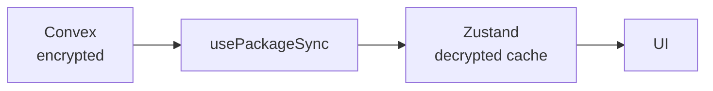

# CHGK Web Suite

Веб-приложение для работы с пакетами ЧГК с E2E шифрованием.

## Стек

- **Runtime:** Bun (не Node.js/npm/pnpm)
- **Framework:** Next.js 16 (App Router)
- **Auth:** Clerk
- **Database:** Convex
- **UI:** shadcn/ui + Tailwind CSS v4
- **State:** Zustand
- **Data fetching:** TanStack React Query
- **Tables:** TanStack Table
- **Linter/Formatter:** Biome (не ESLint/Prettier)
- **Crypto:** Web Crypto API (AES-256-GCM, ECDH)
- **DOCX parsing:** mammoth.js + jszip
- **Export:** docx, pptxgenjs

## Команды

```bash
bun dev          # Запуск dev сервера
bun build        # Сборка
bun lint         # Проверка Biome
bun lint:fix     # Исправление Biome
bun format       # Форматирование
```

## Структура

```
app/                    # Next.js App Router
  (auth)/              # Страницы авторизации
  (dashboard)/         # Защищенные страницы
components/
  ui/                  # shadcn компоненты
  editor/              # Редакторы вопросов/пакетов
  parser/              # Импорт DOCX
  export/              # Экспортеры
lib/
  crypto/              # E2E шифрование
  parser/              # Парсер вопросов
  export/              # Генерация форматов
  typography/          # Типографика
convex/                # Convex схема и функции
hooks/                 # React хуки
stores/                # Zustand stores
```

## Синхронизация данных



- **usePackageSync(packageId)** - хук синхронизации, подписывается на Convex через WebSocket
- **usePackageStore** - Zustand store с кэшем расшифрованных данных
- При изменении в Convex данные автоматически дешифруются и обновляются в store

## Правила

- Без эмодзи в коде и комментариях
- Conventional Commits без подписи
- Русский язык в UI, английский в коде
- Вся криптография на клиенте (E2E)
- Biome для линтинга и форматирования

## Next.js 16

- `middleware.ts` переименован в `proxy.ts`
